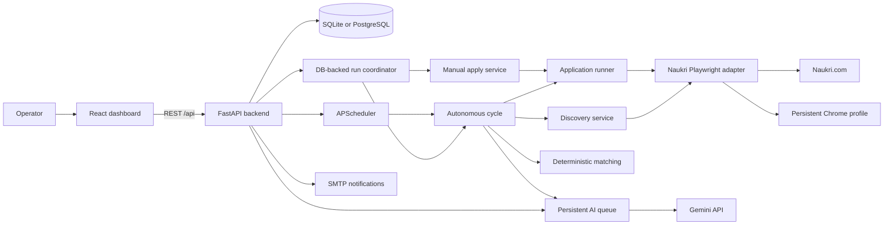
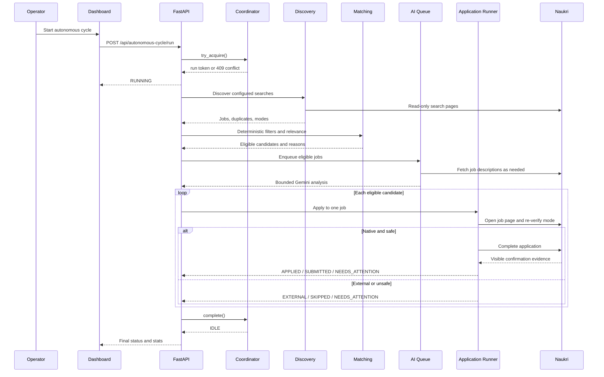
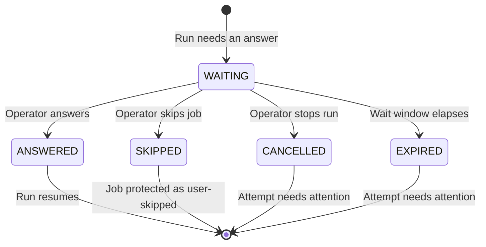

# Naukri AI Job Application Agent

A local-first job-search agent for Naukri.com. It discovers jobs, applies deterministic eligibility rules, uses Gemini for bounded advisory analysis, and submits native Naukri applications through a persistent Playwright browser session.

The system is designed around one rule: **the agent must never claim an application it did not make.** AI is advisory, Python rules are authoritative, external applications are never submitted, and `APPLIED` requires visible confirmation evidence.

- **Current implementation:** E5-R33 (`37b35ed`)
- **Last documentation verification:** 2026-11-01
- **Verified state:** 1,438 backend tests passed, 0 failed; frontend production build passed.

---

## Contents

- [What it does](#what-it-does)
- [Safety model](#safety-model)
- [Architecture](#architecture)
- [Tech stack](#tech-stack)
- [Quick start](#quick-start)
- [First-run checklist](#first-run-checklist)
- [Using the application](#using-the-application)
- [How a run works](#how-a-run-works)
- [Screening questions and human-in-the-loop](#screening-questions-and-human-in-the-loop)
- [Configuration](#configuration)
- [Testing](#testing)
- [Project layout](#project-layout)
- [Deployment](#deployment)
- [Current limitations](#current-limitations)
- [Documentation](#documentation)

---

## What it does

- **Discovers Naukri jobs** across configured locations and target roles, with pagination, freshness-first ordering, canonical-URL deduplication, and application-mode classification.
- **Filters deterministically** against a confirmed profile and saved preferences: target titles, locations, employment type, experience, disclosed salary, IT scope, duplicate history, and job relevance.
- **Runs a bounded AI stage** through Gemini and a persistent AI queue. AI analysis is advisory; only an explicit suspicious flag can block a job.
- **Applies natively on Naukri** using a shared Playwright browser session, with mode re-verification immediately before the click.
- **Supports manual apply batches** over jobs already in the local database. Manual apply never runs discovery and uses the same safety gates as the autonomous cycle.
- **Handles screening questions** through saved memory, profile facts, AI generation, and human-in-the-loop review.
- **Protects prior applications** with a shared application-history rule. A job with any blocking history is never re-attempted.
- **Recovers safely** from stale sessions, ambiguous submissions, interrupted batches, and browser restarts.
- **Reports truthfully** through an operations dashboard: run state, per-job progress, outcomes, queue health, attention items, analytics, activity, and notifications.

## Safety model

The safety model is deliberately conservative:

| Boundary | Behavior |
|---|---|
| External applications | Never clicked or submitted. External-only jobs are excluded from native apply queues. |
| `APPLIED` status | Requires positive visible evidence. A click or URL change is not evidence. |
| Ambiguous submission | Reconciled against Naukri history before `NEEDS_ATTENTION`; never retried blindly. |
| CAPTCHA / security challenge | Stops the attempt and records `NEEDS_ATTENTION`; never bypassed. |
| Prior application history | Blocking statuses always win, even when a `SKIPPED` row also exists. |
| User skip | Protected from future runs; no bulk reset exists. |
| Concurrent runs | One DB-backed singleton lock across autonomous, manual, and scheduler apply paths. |
| Browser profile | One exclusive profile lock prevents two processes from driving the same Chrome profile. |
| AI authority | Gemini cannot approve a job that deterministic rules reject. |
| Candidate facts | Answers come from the profile or an explicit user answer; the agent does not invent credentials or personal facts. |
| Scheduler | Never auto-starts on backend startup. A run begins only from an explicit action. |

## Architecture



The backend owns all state transitions. The React app is an operations console: it reads status, starts or stops explicit workflows, answers pending screening questions, and edits the profile and preferences. It does not drive the browser directly.

See [docs/ARCHITECTURE.md](docs/ARCHITECTURE.md) for component boundaries, run lifecycles, and data-flow details.

## Tech stack

**Backend**

- Python 3.12+
- FastAPI and Uvicorn
- SQLAlchemy 2 with SQLite locally and PostgreSQL support
- Pydantic and pydantic-settings
- Google Gemini via `google-genai`
- Playwright with a persistent Chrome profile
- APScheduler
- PyMuPDF for resume text extraction
- pytest and httpx

**Frontend**

- React 19
- TypeScript 5.8
- Vite 6
- Tailwind CSS 4
- lucide-react

## Quick start

### Prerequisites

- Windows 10/11 for live browser automation
- Python 3.12 or newer
- Node.js 20 or newer
- Google Chrome
- A Gemini API key
- A Naukri account

### 1. Create the backend environment

```powershell
python -m venv .venv
.\.venv\Scripts\Activate.ps1
python -m pip install --upgrade pip
pip install -r requirements.txt
playwright install chromium
```

### 2. Configure the backend

```powershell
Copy-Item .env.example .env
```

Edit `.env` and set at least:

```dotenv
NAUKRI_AGENT_GEMINI_API_KEY=your_gemini_api_key
```

The default local database is `sqlite:///./data/naukri_agent.db`. The default browser profile is `.agent/browser_session`.

### 3. Start the backend

```powershell
python -m uvicorn backend.main:app --host 127.0.0.1 --port 8000
```

Use this **without `--reload`** when you intend to run browser automation. On Windows, Uvicorn's reload worker can select an event loop that Playwright's subprocess driver cannot use.

For UI-only development, `python run.py` also works, but it enables reload in development mode. Do not use reload for live application runs.

### 4. Start the frontend

In a second terminal:

```powershell
Set-Location frontend
npm ci
npm run dev
```

Open [http://127.0.0.1:5173](http://127.0.0.1:5173).

### 5. Optional: verify the API

```powershell
Invoke-RestMethod http://127.0.0.1:8000/api/health
Invoke-RestMethod http://127.0.0.1:8000/api/readiness
```

API documentation is available in development at [http://127.0.0.1:8000/api/docs](http://127.0.0.1:8000/api/docs).

## First-run checklist

1. **Upload a PDF resume** on the Profile page (maximum 10 MB).
2. Review the extracted profile and **confirm it**. Automation refuses to run with an unconfirmed profile.
3. Configure **Preferences**: target job titles, locations, employment types, maximum required experience, and minimum disclosed salary.
4. Start a discovery or apply run. When the persistent Chrome window opens, **log in to Naukri manually** if prompted. The session is reused on later runs.
5. Watch the Overview page. If a screening question needs a human answer, the run enters `WAITING_FOR_USER`.
6. Review any `NEEDS_ATTENTION` items before retrying.

The agent does not store your Naukri password. Login happens in the browser profile.

## Using the application

| Page | Purpose |
|---|---|
| **Overview** | Live run state, start/stop controls, progress, queue health, recent applications, and items waiting on you. |
| **Jobs** | Discovered jobs with filters, match information, application mode, and job details. |
| **Apply Queue** | Jobs already in the local database that can be applied to manually. Supports search, eligibility filtering, multi-select, dry run, skip, and stop. |
| **Applications** | Application history with status filters, confirmation evidence, and detail drawers. |
| **Needs Attention** | Unresolved attempts that require human review. |
| **AI Queue** | Persistent Gemini work queue: queued, processing, completed, retry-pending, quota-blocked, needs-attention, and failed items. |
| **Analytics** | Backend-computed outcome, skip-reason, and decision statistics. |
| **Activity** | Recent application events. |
| **Notifications** | Operational notification stream. |
| **Profile** | Resume upload, extraction review, editing, and confirmation. |
| **Preferences** | Job-search scope and application strategy. |

### Autonomous cycle vs manual apply

**Autonomous cycle** starts with discovery, then filters, evaluates, and applies to eligible jobs in one run.

**Manual apply** never runs discovery. It only considers jobs already stored locally, and applies the same protection, relevance, hard-filter, external-boundary, evidence, and screening rules. Both paths share the singleton apply lock, so they cannot drive the browser at the same time.

### Dry run

Manual apply supports a dry-run mode that inspects the application surface without submitting. It records a pre-apply dry-run row but never performs a remote application action.

## How a run works



The candidate pipeline is intentionally layered:

1. **Discovery** finds jobs and records mode, freshness, and canonical identity.
2. **Relevance** rejects clearly unrelated roles before expensive work.
3. **Hard filters** enforce profile and preference rules deterministically.
4. **Protection** removes jobs with blocking application history or a user skip.
5. **AI analysis** adds advisory judgment and a suspicious flag.
6. **Final safety gate** re-checks the same deterministic boundaries.
7. **Runner** re-verifies application mode and requires evidence after submission.

No single stage can override an earlier safety rejection.

## Screening questions and human-in-the-loop

Screening answers are resolved in this order:

1. Saved scoped answer memory
2. Confirmed profile facts
3. Bounded Gemini generation
4. Human-in-the-loop question

Answer memory has three scopes: `GLOBAL`, `EMPLOYER`, and `JOB`. Sensitive questions such as passwords, OTPs, and tokens are never stored or auto-answered. Context-sensitive answers require explicit authorization before global reuse. Profile-sourced answers become stale when the profile changes, and option-based answers become stale when the available options change.



While waiting, the browser session is not advanced. The run's lock remains held, and the dashboard shows `WAITING_FOR_USER`.

## Configuration

Configuration is loaded from `.env` with the `NAUKRI_AGENT_` prefix. The table lists common settings; `.env.example` is the full reference.

| Variable | Default | Notes |
|---|---|---|
| `NAUKRI_AGENT_APP_ENV` | `development` | `production` enables production logging and stricter readiness checks. |
| `NAUKRI_AGENT_APP_HOST` | `127.0.0.1` | Backend bind address. |
| `NAUKRI_AGENT_APP_PORT` | `8000` | Backend port. |
| `NAUKRI_AGENT_DATABASE_URL` | `sqlite:///./data/naukri_agent.db` | PostgreSQL is supported for hosted deployments. |
| `NAUKRI_AGENT_GEMINI_API_KEY` | unset | Required for AI functionality and production readiness. |
| `NAUKRI_AGENT_GEMINI_MODEL` | `gemini-flash-lite-latest` | Must support structured JSON output. |
| `NAUKRI_AGENT_FRONTEND_ORIGINS` | unset | Comma-separated CORS origins. Required in production; wildcards are rejected. |
| `NAUKRI_AGENT_BROWSER_TYPE` | `chrome` | Browser channel used by Playwright. |
| `NAUKRI_AGENT_BROWSER_USER_DATA_DIR` | `.agent/browser_session` | Persistent login/profile directory. |
| `NAUKRI_AGENT_SCHEDULER_ENABLED` | `true` | Enables scheduler configuration; startup still does not auto-start it. |
| `NAUKRI_AGENT_SCHEDULER_INTERVAL_MINUTES` | `60` | Scheduler interval. |
| `NAUKRI_AGENT_MAX_RESUME_FILE_SIZE_BYTES` | `10485760` | 10 MB resume limit. |
| `NAUKRI_AGENT_NOTIFICATION_EMAIL` | unset | Optional notification recipient. |
| `NAUKRI_AGENT_SMTP_*` | unset | Optional SMTP delivery settings. |

Frontend configuration uses `VITE_API_BASE_URL`:

```dotenv
VITE_API_BASE_URL=http://127.0.0.1:8000
```

If omitted in development, the client falls back to `http://127.0.0.1:8000`. Never put API keys or credentials in a `VITE_` variable; those values are exposed to the browser.

## Testing

Backend tests are offline by default. Some adapter tests use a real local Chromium instance but abort network requests and never contact Naukri.

```powershell
.\.venv\Scripts\python.exe -m pytest backend/tests -q
```

If a live backend or Chrome is already using the default persistent profile, point the test run at an isolated profile:

```powershell
$env:NAUKRI_AGENT_BROWSER_USER_DATA_DIR = Join-Path $env:TEMP ("naukri-tests-" + [guid]::NewGuid())
.\.venv\Scripts\python.exe -m pytest backend/tests -q
```

Frontend build:

```powershell
Set-Location frontend
npm run build
```

Verified on 2026-11-01:

- `1438 passed, 34 warnings` in the backend suite
- `npm run build` passed with 1,610 modules transformed

## Project layout

```text
backend/
  api/routes/          FastAPI route modules
  core/                Settings, logging, exceptions
  database/            Engine, sessions, schema initialization
  models/              SQLAlchemy models
  schemas/             Pydantic request/response contracts
  services/
    applications/      Runner, protection, answer memory, reconciliation
    autonomous_cycle/  Cycle orchestration and DB-backed coordinator
    discovery/         Naukri discovery and deduplication
    gemini/            Gemini provider, prompts, persistent AI queue
    manual_apply/      Manual apply queue and eligibility
    matching/          Deterministic filters, relevance, normalization
    naukri/            Playwright adapter and page interactions
    scheduler/         Scheduled discovery/apply orchestration
  tests/               Offline backend test suite
frontend/
  src/app/             App shell, navigation, page routing
  src/pages/           Dashboard pages
  src/components/      Shared workflow components
  src/ui/              Reusable presentation primitives
  src/services/        API client
  src/types/           API and UI types
docs/
  ARCHITECTURE.md
  DECISIONS.md
  DEVELOPMENT_STATUS.md
  MASTER_PRD.md
  FUTURE_IMPLEMENTATION_ROADMAP.md
  API.md
  archive/             Historical snapshots through E5-R23
```

## Deployment

The frontend and backend deploy separately.

**Frontend**

- Vercel project root: `frontend`
- Build command: `npm run build`
- Output: `frontend/dist`
- Set `VITE_API_BASE_URL` to the public HTTPS backend origin.

There is no root `vercel.json`; the project root setting drives the build.

**Backend**

- Run `uvicorn backend.main:app --host 0.0.0.0 --port $PORT`.
- Use PostgreSQL for a hosted environment.
- Set `NAUKRI_AGENT_APP_ENV=production`, `NAUKRI_AGENT_DATABASE_URL`, `NAUKRI_AGENT_GEMINI_API_KEY`, and explicit `NAUKRI_AGENT_FRONTEND_ORIGINS`.
- `/api/readiness` reports production configuration errors.

**Security note:** the application has no built-in user authentication. Treat it as a trusted-local or trusted-network service. Add authentication at a reverse proxy or API gateway before exposing it to the public internet. Browser automation itself requires a Windows environment with Chrome and Playwright.

## Current limitations

- Naukri is the only supported job platform.
- Live browser automation is Windows-first. Hosted API deployment does not provide a cloud browser.
- The system is single-user and has no built-in authentication or multi-tenant isolation.
- CAPTCHA and security challenges stop automation; they are not bypassed.
- External applications are recorded but never submitted.
- AI output is advisory and can be unavailable during quota exhaustion; deterministic rules still apply.
- `max_applications` is accepted for compatibility but is display-only. Runs process eligible jobs until the queue is exhausted or a stop condition occurs.
- There is no bulk reset for `NEEDS_ATTENTION` items by design.
- Current UI screenshots are not committed. The page inventory above is the authoritative UI description for this revision.

## Documentation

- [Documentation index](docs/README.md)
- [Architecture](docs/ARCHITECTURE.md)
- [API reference](docs/API.md)
- [Architecture decisions](docs/DECISIONS.md)
- [Development status](docs/DEVELOPMENT_STATUS.md)
- [Product requirements](docs/MASTER_PRD.md)
- [Future roadmap](docs/FUTURE_IMPLEMENTATION_ROADMAP.md)
- [Historical snapshots through E5-R23](docs/archive/README.md)
- [Phase 9 validation records](docs/PHASE_9_AUDIT.md)

The README is the entry point. Historical checkpoint narratives are retained in `docs/archive/` and the decision log; they are not a description of the current runtime.
