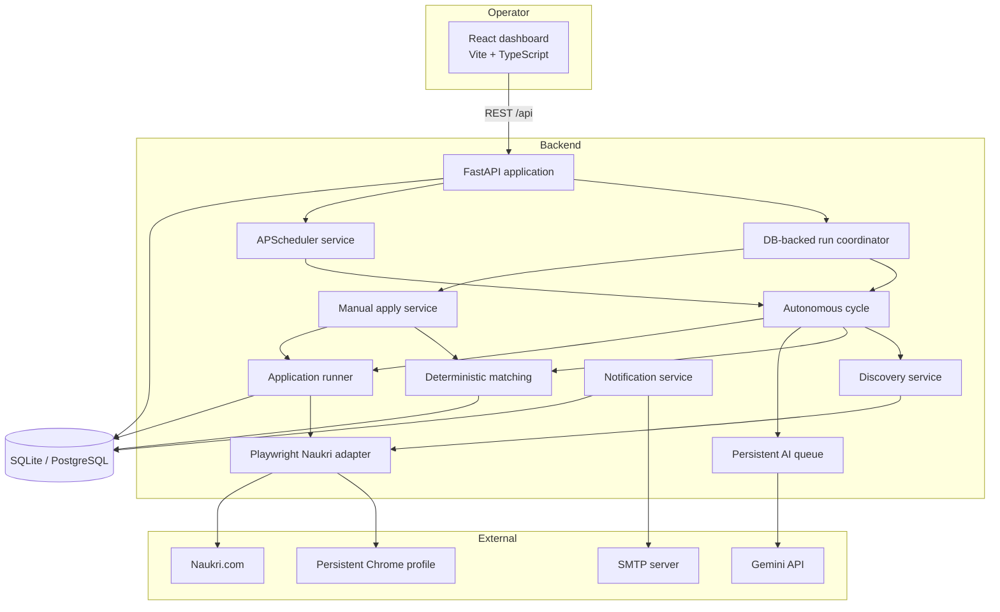
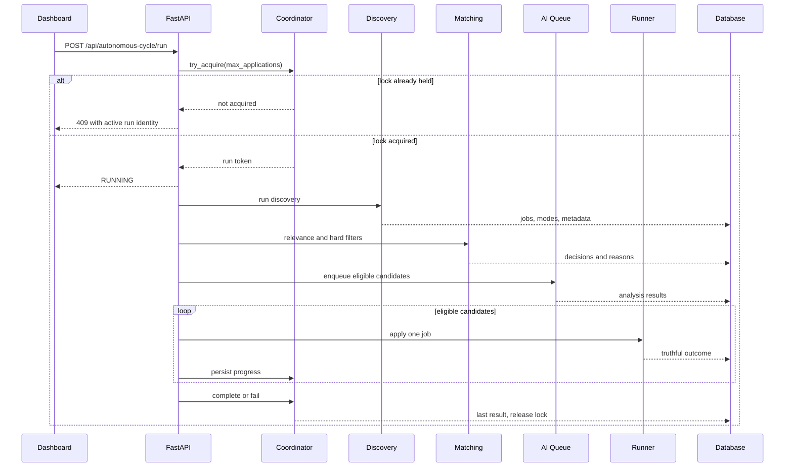
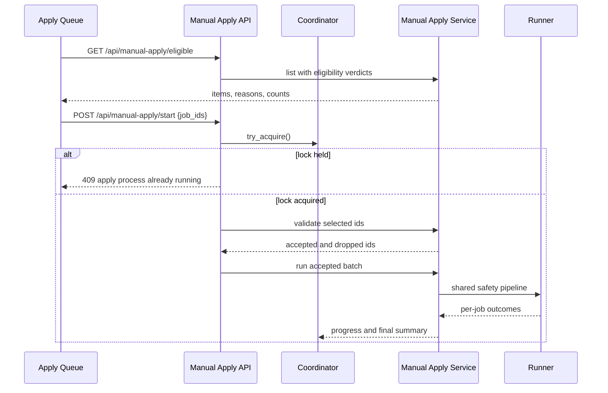
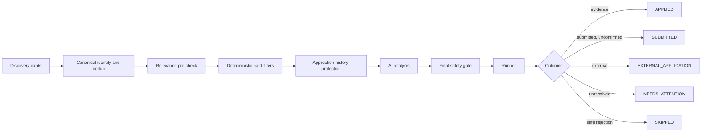
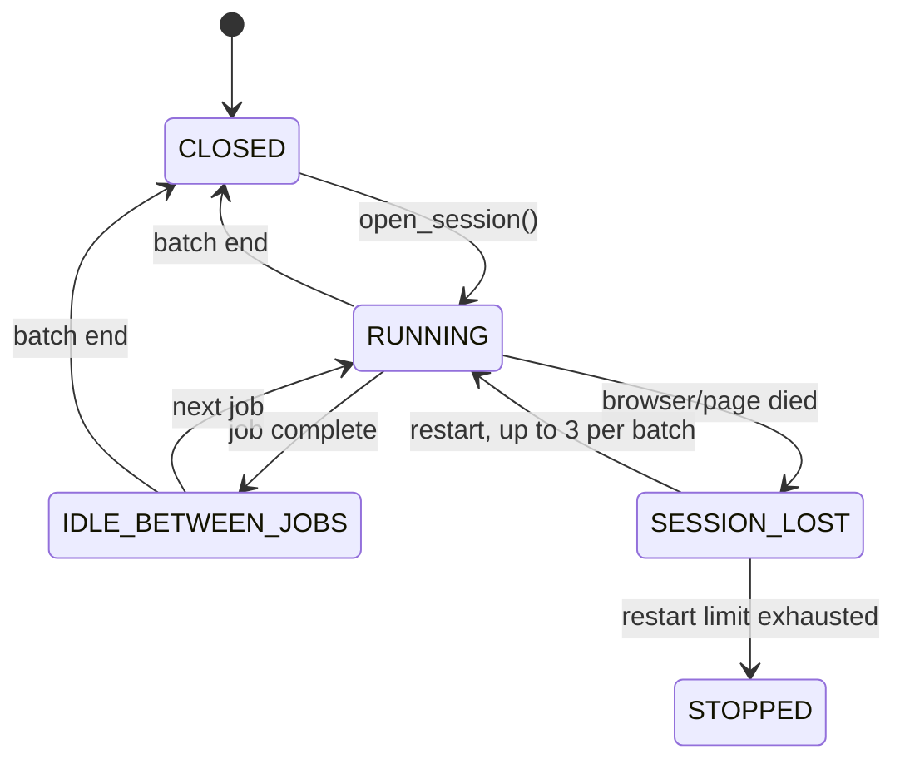
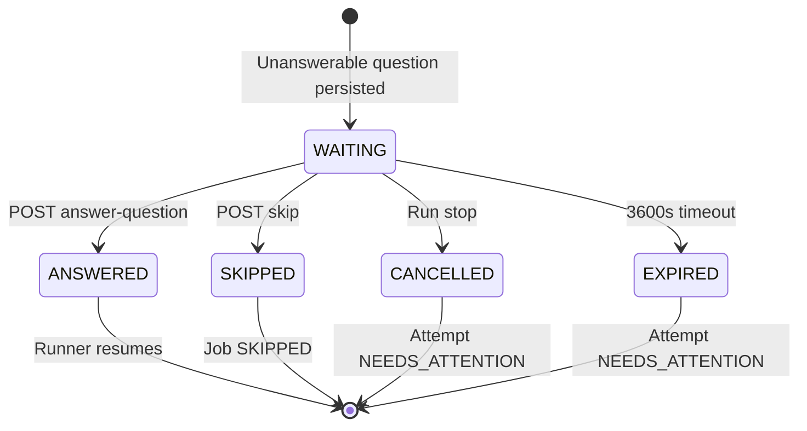
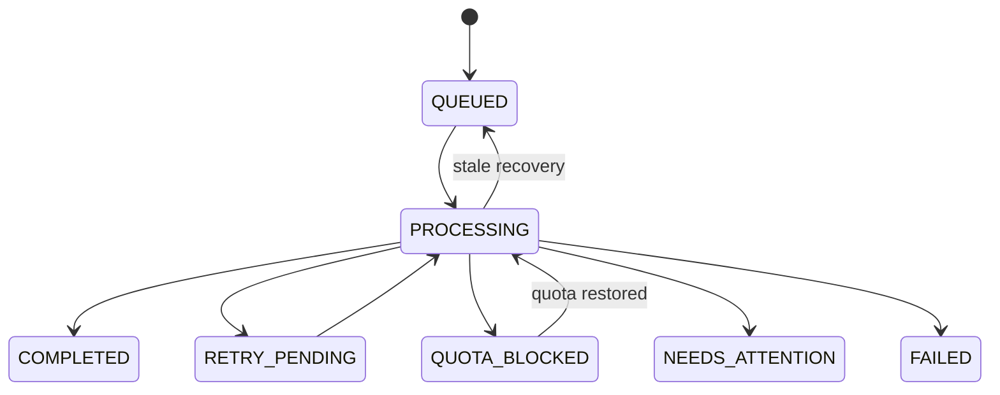
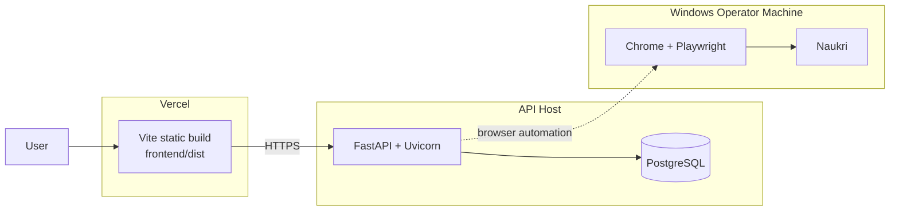

# Architecture

- **Current implementation:** E5-R33 (`37b35ed`)
- **Verified:** 2026-11-01
- **Scope:** local-first Naukri automation with a React operations console and a FastAPI backend.

This document describes the current system. Historical designs and checkpoint narratives are preserved in [`docs/archive/`](archive/README.md) and in the [decision log](DECISIONS.md).

---

## 1. System context



The backend is the only component that mutates application state. The frontend is an operations console: it observes status and issues explicit commands. It does not control the browser directly.

---

## 2. Runtime components

| Component | Location | Responsibility |
|---|---|---|
| API application | `backend/main.py` | Lifespan initialization, CORS, exception handling, router registration. |
| Settings | `backend/core/config.py` | Environment-driven configuration with the `NAUKRI_AGENT_` prefix. |
| Database | `backend/database/` | SQLAlchemy engine/session management and idempotent schema initialization. |
| Coordinator | `backend/services/autonomous_cycle/coordinator.py` | DB-backed singleton apply lock, run identity, cancellation, progress, and last-run persistence. |
| Autonomous cycle | `backend/services/autonomous_cycle/service.py` | Discovery → filters → AI queue → final gate → runner orchestration. |
| Manual apply | `backend/services/manual_apply/service.py` | Eligibility listing and explicit apply batches over stored jobs. |
| Discovery | `backend/services/discovery/service.py` | Search groups, pagination, deduplication, metadata, and progress reporting. |
| Matching | `backend/services/matching/` | Deterministic hard filters, relevance checks, title scope, salary parsing, URL normalization. |
| AI queue | `backend/services/gemini/queue.py` | Durable queue for Gemini analysis with retry and quota states. |
| Gemini provider | `backend/services/gemini/provider.py` | Structured profile extraction, job analysis, and answer generation. |
| Application runner | `backend/services/applications/runner.py` | Browser session lifecycle, form completion, screening, evidence, recovery. |
| Protection | `backend/services/applications/protection.py` | Shared application-history and user-skip protection rule. |
| Answer memory | `backend/services/applications/answer_memory.py` | Scoped screening answers, staleness, sensitive-question blocking. |
| Naukri adapter | `backend/services/naukri/adapter.py` | Playwright navigation, discovery, classification, form detection, click and submit helpers. |
| Scheduler | `backend/services/scheduler/service.py` | Periodic orchestration; shares the apply lock. |
| Browser session lock | `backend/services/browser_session_lock.py` | Cross-process exclusive ownership of the persistent browser profile. |
| Lifecycle | `backend/services/lifecycle/` | Explicit start/stop/pause/resume and startup recovery. |
| Notifications | `backend/services/notifications/` | Persisted notification events and optional email delivery. |

---

## 3. Application state and data model

Core persisted entities:

| Entity | Purpose |
|---|---|
| `Profile` | Resume metadata and confirmed structured candidate facts. |
| `JobPreference` | Search scope, target titles, locations, employment types, experience, salary floor, aggressiveness, IT allowlists. |
| `Job` | Discovered listing, canonical URL, description, location, experience, salary, posted date, application mode, status. |
| `Application` | One attempt or outcome for a job, including status, method, evidence, skip/failure reason, and reconciliation flags. |
| `ApplicationAnswer` | Question/answer records attached to an application attempt. |
| `ScreeningAnswer` | Reusable scoped answer memory with source, verification, staleness, and reuse metadata. |
| `PendingQuestion` | Human-in-the-loop question lifecycle for an active run. |
| `AIQueueItem` | Durable Gemini work item with attempts, retry timing, and failure state. |
| `JobAnalysisModel` | Cached structured Gemini analysis. |
| `DiscoveryRun` | Discovery execution record and counters. |
| `CycleRunControl` | Singleton control row for the apply lock, active run, cancellation, progress, and last result. |
| `Notification` | Persisted operational event. |
| `Worker` | Worker registration and heartbeat state for coordinated AI work. |

### Application statuses

```text
PRE_APPLY
DISCOVERED
FILTERED
AI_ANALYZED
APPROVED_BY_RULES
APPLICATION_STARTED
APPLIED
SUBMITTED
EXTERNAL_APPLICATION
NEEDS_ATTENTION
SKIPPED
```

`APPLIED` is evidence-backed. `SUBMITTED` is used when a submission was performed but could not be positively confirmed. `NEEDS_ATTENTION` is an unresolved outcome, not a success or a generic failure.

### Agent states

```text
IDLE
RUNNING
SEARCHING
FILTERING
ANALYZING
APPLYING
PAUSED
AUTH_REQUIRED
SECURITY_REQUIRED
AI_QUOTA_EXHAUSTED
NEEDS_ATTENTION
STOPPED
CRITICAL_ERROR
```

The cycle's durable `active_state` is intentionally narrower than the process-local agent state. A historical terminal result is never reported as an active run.

---

## 4. Run orchestration

### 4.1 Autonomous cycle



Key properties:

- `POST /api/autonomous-cycle/run` is the only autonomous start trigger.
- The coordinator claims a singleton row atomically; duplicate starts receive `409`.
- The scheduler does not auto-start on backend startup.
- Discovery progress is persisted per search and surfaced in the UI.
- A run processes all eligible candidates unless stopped or a terminal condition occurs.
- `max_applications` remains in the request schema for compatibility but is ignored.

### 4.2 Manual apply

Manual apply is an operator-selected batch over jobs already in the local database.



Manual apply never runs discovery. It uses the same protection, relevance, hard-filter, external-boundary, evidence, session-recovery, and screening code paths as the autonomous cycle.

### 4.3 Scheduler

The scheduler is an optional periodic orchestrator. It shares the singleton apply lock with the autonomous cycle and manual apply. It can be started, stopped, paused, resumed, and configured through `/api/scheduler/*`. It is not automatically started by application startup.

---

## 5. Candidate pipeline



### 5.1 Discovery

- Builds searches from configured target titles and locations.
- Supports pagination and multiple locations.
- Classifies application mode during discovery when possible: `NAUKRI_NATIVE`, `EXTERNAL`, or `AMBIGUOUS`.
- Deduplicates by canonical URL variants and job identity.
- Applies a relevance pre-check before expensive lookups and backfills.
- Parses posted dates only when grounded; unknown dates are never fabricated.
- Persists discovery progress so a long sweep is legible.

### 5.2 Relevance

The shared relevance gate rejects clearly unrelated roles before they become candidates. It combines:

- Curated target-role families
- Unwanted specializations
- Role-scope and responsibility phrases
- Strong single-hit exclusions
- Title and description context
- Configured target titles

The same gate is used by matching, candidate selection, the final safety gate, and manual eligibility so the same job does not receive contradictory verdicts.

### 5.3 Deterministic hard filters

Hard filters are authoritative. They cover:

- Confirmed profile required
- Preferences required
- Target title scope
- Location
- Required experience
- Disclosed salary floor
- Employment type
- IT-scope policy
- Duplicate application history
- Expired listings
- External-only jobs for native apply
- Suspicious-job flag

Unknown values are handled honestly. For example, an undisclosed salary is not treated as below the floor.

### 5.4 AI analysis

Gemini produces structured analysis and recommendations. The analysis is advisory:

- It can add a `suspicious` flag that blocks a job.
- It cannot override a deterministic rejection.
- Quota exhaustion is recorded as `QUOTA_BLOCKED`; it is not treated as a completed analysis.
- Jobs without analysis can still proceed through deterministic fallback where supported.

### 5.5 Final safety gate

The final gate re-applies the same deterministic boundaries immediately before application. This prevents a stale decision from surviving a preference change, a new application row, or a mode reclassification.

---

## 6. Protection semantics

`backend/services/applications/protection.py` is the single source of truth.

A job is protected when any of the following is true:

- It has an application row with a blocking status:
  - `DISCOVERED`
  - `PRE_APPLY`
  - `APPLICATION_STARTED`
  - `APPLIED`
  - `SUBMITTED`
  - `NEEDS_ATTENTION`
- It has a user-initiated `SKIPPED` row (`USER_SKIPPED` prefix).
- It has application rows but none of them is a deliberate `SKIPPED` row.

A job with no application rows is eligible. A job whose only rows are ordinary `SKIPPED` rows is re-processable. A blocking row always wins over an ordinary skip.

Two access patterns exist:

- A correlated SQL predicate for unbounded candidate queries.
- A bounded bulk helper for explicit ID sets.

The rule is a strict superset of the legacy per-row rule. It never weakens protection.

---

## 7. Browser and session lifecycle

The runner uses one shared Playwright session per batch.



Rules:

- The persistent Chrome profile is protected by a cross-process file lock.
- A session is opened once and reused across jobs.
- A session loss detected **before** an attempt may restart the session and retry that job.
- At most three mid-run session restarts are allowed per batch.
- A session loss **during** an attempt is not retried blindly; it becomes `NEEDS_ATTENTION`.
- Restart failure records a truthful skip, not a fabricated error or success.
- Stop requests are honored between jobs and before a restart.
- Remaining jobs are reported as never started when a run is cancelled.

---

## 8. Application completion and evidence

The runner follows a mode-first, evidence-last contract:

1. Open the job page.
2. Re-verify whether the listing is native, external, or ambiguous.
3. Never force a native application without a visible native Apply control.
4. Complete the form or conversational drawer.
5. Submit only through a safe, non-occluded control.
6. Require positive visible confirmation evidence before `APPLIED`.
7. Reconcile ambiguous submissions against Naukri history.
8. Record an unresolved attempt as `NEEDS_ATTENTION` when evidence is absent.

Conversational applications have bounded loops:

- At most 12 steps.
- At most 2 prompt handles.
- At most 8 answers.

Nudges are dismissed, not answered. A repeated unchanged nudge terminates the attempt rather than looping.

---

## 9. Screening question lifecycle



The wait loop polls through short-lived database sessions so API commits are visible. After an answered wait, the runner re-validates the Naukri login before continuing. A logged-out session becomes `AUTH_REQUIRED`.

### Answer memory

Scopes:

- `GLOBAL`: reusable across employers.
- `EMPLOYER`: reusable for one employer.
- `JOB`: reusable only for one job.

Safeguards:

- Sensitive questions (password, OTP, token, and similar) are never stored or auto-answered.
- Context-sensitive families require explicit authorization for global reuse.
- Profile-sourced answers carry a profile hash and go stale when the profile changes.
- Option-based answers go stale when the option list changes.
- Scopes never widen silently.

---

## 10. AI queue

The AI queue is durable and independent of any single cycle.



Statuses:

```text
QUEUED
PROCESSING
COMPLETED
RETRY_PENDING
QUOTA_BLOCKED
NEEDS_ATTENTION
FAILED
```

The queue supports native-first priority, retries, stale-item recovery, and worker ownership. Analysis results are cached and reused by job/profile context.

---

## 11. Concurrency and locking

Two locks protect the runtime:

### Apply lock

`CycleRunControl` is a singleton database row. Acquisition is an atomic conditional update. The lock is shared by:

- Autonomous cycle
- Manual apply
- Scheduler apply phase

A second process receives `409` with the active run identity. The lock is released on completion, failure, or cancellation.

### Browser profile lock

`BrowserSessionLock` prevents two processes from opening the same persistent Chrome profile. This matters because Chrome itself cannot safely share a user-data directory.

### Coordination behavior

- Stop is idempotent.
- Cancellation is checked between jobs and before starting an application.
- A run that is cancelled reports `CANCELLED`, not `COMPLETED`.
- Startup recovery returns the process to `IDLE`; it does not resume a prior run automatically.
- The scheduler does not auto-start.

---

## 12. Frontend architecture

```text
frontend/src/
  app/
    App.tsx          data loading, polling, page composition, global actions
    shell.ts         page IDs and navigation context
  pages/
    OverviewPage
    JobsPage
    ApplyQueuePage
    ApplicationsPage
    NeedsAttentionPage
    AIQueuePage
    AnalyticsPage
    ActivityPage
    NotificationsPage
    ProfilePage
    PreferencesPage
  components/
    AgentControl
    ProfileWorkspace
    ScreeningQuestionPanel
    JobPreferences
    StateBlocks
  ui/
    PageHeader, StatCard, StatusBadge, ProgressPanel,
    JobCard, DataTable, DetailDrawer, ConfirmAction,
    SearchFilterBar, QueueSummary, ReasonSummary, Pagination
  services/api.ts
  types/api.ts
  styles.css
```

Design properties:

- Single-page application with in-memory page state; no client-side router.
- The shell provides navigation and the global waiting-for-answer state.
- Data is fetched from explicit API endpoints; no mock data is used in production paths.
- Polling is used for live run and queue status; there are no WebSockets.
- Loading, empty, and error states are explicit.
- The UI never fabricates progress or outcome counts.
- Destructive actions use confirmation controls.
- The layout is responsive and includes a mobile bottom navigation.

---

## 13. API surface

The API is organized by workflow:

| Group | Prefix | Purpose |
|---|---|---|
| Health | `/api` | Liveness and readiness. |
| AI provider | `/api/ai` | Gemini provider status and configuration summary. |
| Profile | `/api/profile` | Resume upload, extraction, update, confirm. |
| Matching | `/api/matching` | Preferences and deterministic evaluation. |
| Discovery | `/api/discovery` | Start/stop/status. |
| Autonomous cycle | `/api/autonomous-cycle` | Run/stop/status, pending question, answer memory. |
| Manual apply | `/api/manual-apply` | Eligible jobs, start/stop/status, per-job skip. |
| Applications | `/api/applications` | History, detail, run/start/stop, reconciliation. |
| Dashboard | `/api/dashboard` | Summary, jobs, applications, attention. |
| AI queue | `/api/ai-queue` | Enqueue, inspect, claim, process, mark states, recover. |
| Scheduler | `/api/scheduler` | Start/stop/pause/resume/config/status. |
| Lifecycle | `/api/agent` | Start/stop/pause/resume/recovery/status. |
| Analytics | `/api/analytics` | Outcome and decision statistics. |
| Notifications | `/api/notifications` | Notification stream. |
| Decision | `/api/decision` | Per-job decision history and prioritization. |
| Feedback | `/api/feedback` | Feedback records and summary. |
| Worker | `/api/worker` | Worker registration, status, heartbeat. |
| System | `/api/system` | Windows autostart controls. |

See [API.md](API.md) for the endpoint list.

---

## 14. Security and trust boundaries

- The backend has no built-in authentication. It is intended for trusted-local or trusted-network use.
- CORS origins are explicit in production; wildcards are rejected.
- Credentials and API keys are read from environment variables and are not returned by dashboard schemas.
- Browser automation uses a persistent profile, not stored passwords.
- External links are recorded, never submitted.
- CAPTCHA and security challenges stop automation.
- Logs are sanitized in production mode.
- Production readiness requires PostgreSQL, a Gemini key, and explicit CORS origins.
- There is no multi-tenant isolation.

If the API is exposed publicly, put it behind an authenticated reverse proxy or gateway and restrict access to the operator.

---

## 15. Failure handling

| Failure | Behavior |
|---|---|
| Discovery login required | Run stops with `LOGIN_REQUIRED`. |
| Security challenge | Attempt records `NEEDS_ATTENTION`; automation stops. |
| Gemini quota exhausted | Queue item becomes `QUOTA_BLOCKED`; no fake analysis. |
| Browser session dies before attempt | Restart and retry, bounded to 3 restarts. |
| Browser session dies during attempt | `NEEDS_ATTENTION`; never blindly retried. |
| Submit ambiguity | History reconciliation, then `NEEDS_ATTENTION` if unresolved. |
| Two consecutive runner errors | Cycle aborts remaining candidates. |
| User stop | Cancellation at the next safe boundary; remaining jobs reported unstarted. |
| Duplicate start | `409` with the active run identity. |
| Stale AI queue item | Recovered to a safe state, never assumed complete. |
| Startup after crash | Process returns to `IDLE`; no automatic resume. |

---

## 16. Deployment architecture



Hosted API deployment does not provide a cloud browser. Live automation still requires a Windows machine with Chrome and Playwright, or a future cloud browser implementation that is not part of the current scope.

---

## 17. Known architectural limitations

- Naukri-only platform support.
- Single-user, no authentication or tenant isolation.
- Windows-first live browser automation.
- No distributed browser workers.
- AI queue coordination supports worker ownership, but the main application workflow is still local-first.
- No WebSocket push; the UI polls.
- `max_applications` is legacy-compatible but ignored.
- External applications are never submitted.
- CAPTCHA is never bypassed.
- Historical checkpoint documents are not a description of current behavior; use this document and the decision log.

---

## 18. Related documents

- [README](../README.md)
- [API reference](API.md)
- [Architecture decisions](DECISIONS.md)
- [Development status](DEVELOPMENT_STATUS.md)
- [Product requirements](MASTER_PRD.md)
- [Future roadmap](FUTURE_IMPLEMENTATION_ROADMAP.md)
- [Historical archive](archive/README.md)
